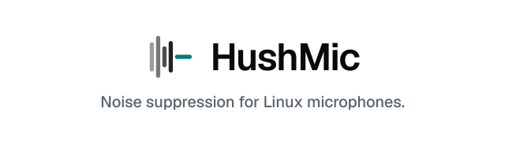
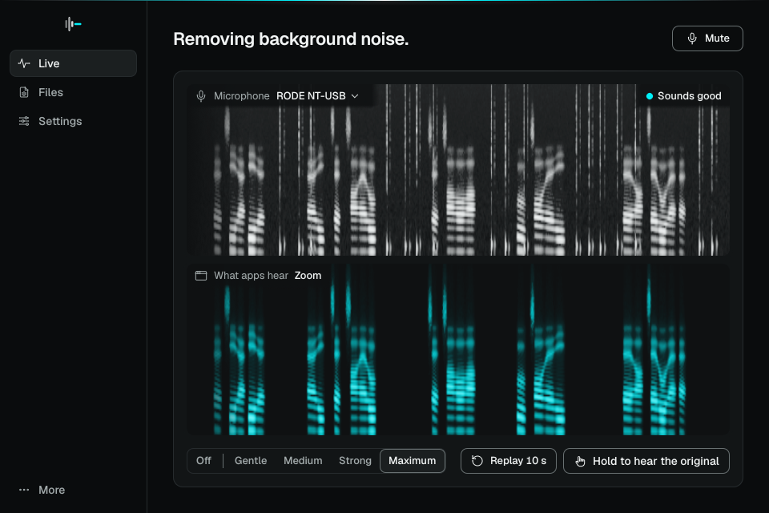

<h1 align="center">
  <picture>
    <source media="(prefers-color-scheme: dark)" srcset="docs/img/hushmic-header-dark.svg">
    
  </picture>
</h1>

<p align="center">
  Removes keyboard, fan and background noise from your microphone in real time.<br>
  Open source, runs on your CPU, and your audio never leaves the machine.
</p>

<p align="center">
  <a href="https://hushmic.org"><b>hushmic.org</b></a> · <a href="https://hushmic.org/clean">clean a file in your browser</a> · <a href="docs/usage.md">docs</a>
</p>

<p align="center">
  <a href="https://github.com/Fovty/hushmic/releases"></a>
  <a href="#license"></a>
  <a href="https://github.com/Fovty/hushmic/actions/workflows/release.yml"></a>
  <a href="https://ko-fi.com/fovty"></a>
</p>

Pick **HushMic** as the microphone in Zoom, Google Meet, Microsoft Teams, Discord, OBS or your browser, and they hear your voice without the keyboard, the fan or the people behind you. It also cleans recordings you already have, audio or video.

## Demo

Each clip plays the noisy input, then the same audio cleaned by HushMic.

<table>
<tr>
<td align="center"><b>Keyboard</b></td>
<td align="center"><b>Fan / AC hum</b></td>
<td align="center"><b>Café chatter</b></td>
</tr>
<tr>
<td><video src="https://github.com/user-attachments/assets/9cc7abe4-26fc-440f-88da-b86ef33df142" controls width="280"></video></td>
<td><video src="https://github.com/user-attachments/assets/d4b396a7-d980-4e0d-bac2-2a119debd768" controls width="280"></video></td>
<td><video src="https://github.com/user-attachments/assets/f4cd4504-d49a-4a46-95c2-01e56cd2d268" controls width="280"></video></td>
</tr>
</table>

Audio sources and licenses: [docs/demo/ASSETS.md](docs/demo/ASSETS.md).

The window shows what goes in and what comes out, and replays the last 10 seconds the way your apps hear you:

<p align="center">
  
</p>

## Install

For Linux on x86-64 with PipeWire and WirePlumber. The install script works on any distro and [checks the sound system](docs/install.md#the-sound-system-check) first:

```bash
curl -fsSL https://raw.githubusercontent.com/Fovty/hushmic/main/scripts/install.sh | sudo sh
```

Or use a package:

```bash
# Debian, Ubuntu
curl -fsSLO https://github.com/Fovty/hushmic/releases/latest/download/hushmic_amd64.deb
sudo apt install ./hushmic_amd64.deb

# Arch (AUR)
yay -S hushmic-bin

# Fedora (COPR)
sudo dnf copr enable fovty/hushmic && sudo dnf install hushmic
```

<details>
<summary>NixOS, AppImage, Flatpak, from source</summary>

```bash
# NixOS (flake, builds from source)
nix run github:Fovty/hushmic-nix -- --tray

# AppImage
curl -fsSLO https://github.com/Fovty/hushmic/releases/latest/download/hushmic-x86_64.AppImage
chmod +x hushmic-x86_64.AppImage && ./hushmic-x86_64.AppImage --tray

# From source
git clone https://github.com/Fovty/hushmic && cd hushmic
./scripts/setup-assets.sh && cargo build --release
```

</details>

Ubuntu 22.04, Flatpak, custom prefixes, upgrading and uninstalling: [docs/install.md](docs/install.md).

Then start HushMic from your application menu and choose **HushMic** as the microphone in your app; the first start walks you through it. More in [docs/usage.md](docs/usage.md), and in [docs/troubleshooting.md](docs/troubleshooting.md) when something is off.

## Why DPDFNet

I wanted noise suppression on Linux that matches Krisp and installs like an app. I ran the three demo clips through the candidates and scored the output with DNSMOS P.835 (1 to 5, higher is better):

| Model                             | Overall | Background | Speech |
| --------------------------------- | :-----: | :--------: | :----: |
| **DPDFNet** (HushMic)             | **3.20** | **4.15**  | **3.43** |
| DeepFilterNet 3                   |  2.97   |    3.98    |  3.26  |
| Krisp v9.9.3                      |  2.57   |    3.96    |  2.81  |
| khip (older Krisp model port)     |  2.43   |    3.78    |  2.71  |
| GTCRN                             |  2.42   |    3.71    |  2.76  |
| RNNoise (EasyEffects default)     |  2.01   |    3.93    |  2.60  |
| Unprocessed input                 |  1.49   |    1.48    |  2.01  |

Three clips are not a formal benchmark, but the source audio is public. Method, per-clip numbers and CPU cost: [docs/comparison.md](docs/comparison.md). DPDFNet is a DeepFilterNet-lineage model by Ceva ([paper](https://arxiv.org/abs/2512.16420)).

## FAQ

**Does my audio go anywhere?** No. Everything runs on the CPU and nothing is uploaded.

**What about other voices in the room?** HushMic keeps speech, so a voice from across the room can come through. **Stay on my voice** in Settings keeps voices farther from the microphone out; people right beside you can sound quieter with it.

**Does turning it off or muting drop my call?** No. Your call app keeps the same microphone, so the call stays connected.

**How much latency and CPU?** 80 ms, and about a tenth of one CPU core on most Intel and AMD CPUs since 2015. When the computer gets busy, HushMic switches to a lighter model on its own.

**Can I script it?** Yes. `hushmic toggle mute`, `hushmic mode off` or `hushmic clean talk.m4a` work from any hotkey tool or script, and it runs [as a service](docs/headless.md) without a tray icon. Every command: [docs/usage.md](docs/usage.md).

**Can I use it in EasyEffects?** Yes, as the DPDFNet model of its Deep Noise Remover: [how](docs/usage.md#using-the-plugin-in-easyeffects).

## How it works

HushMic runs a PipeWire filter chain as a child process, with the DPDFNet model in a LADSPA plugin. PipeWire owns the real-time scheduling, so no `setcap` is needed; a watchdog brings the virtual microphone back after a PipeWire restart or suspend, and quitting restores your previous default input. The model code is a plain Rust library, [`hushmic-denoiser`](crates/hushmic-denoiser), that you can embed in your own app.

## Contributing

Bug reports and ideas are welcome in the [issues](https://github.com/Fovty/hushmic/issues); `hushmic --doctor` prints a report to attach. Pull requests are welcome too; for anything bigger, open an issue first. Translations happen on [Weblate](https://hosted.weblate.org/projects/hushmic/) ([TRANSLATING.md](TRANSLATING.md)). If HushMic is useful to you, a coffee on [Ko-fi](https://ko-fi.com/fovty) helps keep it maintained.

## License

MIT ([LICENSE-MIT](LICENSE-MIT)) or Apache-2.0 ([LICENSE-APACHE](LICENSE-APACHE)), at your option.

The model is [DPDFNet](https://github.com/ceva-ip/DPDFNet) by Ceva (Apache-2.0); the native engine is its authors' C runtime, included unmodified. The plugin follows the architecture of [DeepFilterNet](https://github.com/Rikorose/DeepFilterNet). Built with [PipeWire](https://pipewire.org), [egui](https://github.com/emilk/egui), [ort](https://github.com/pykeio/ort), [rustfft](https://github.com/ejmahler/RustFFT) and [ksni](https://github.com/iovxw/ksni).
