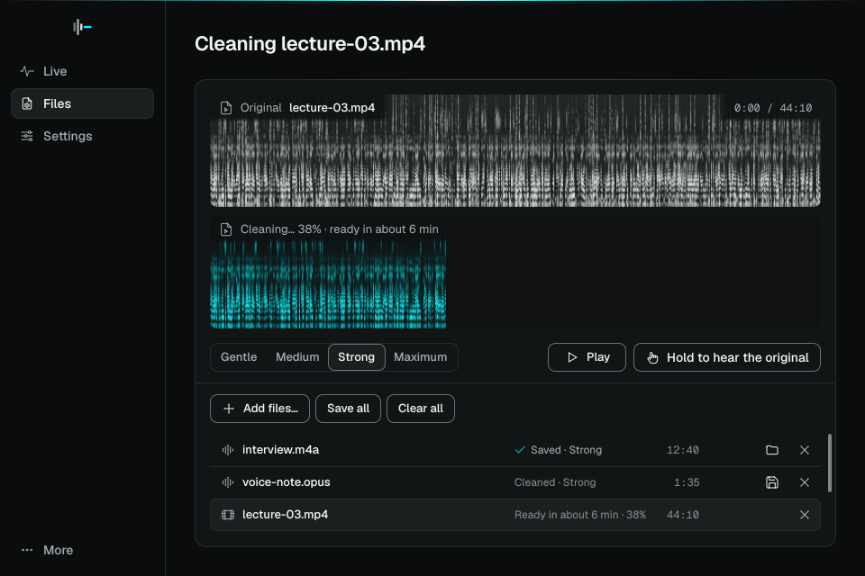
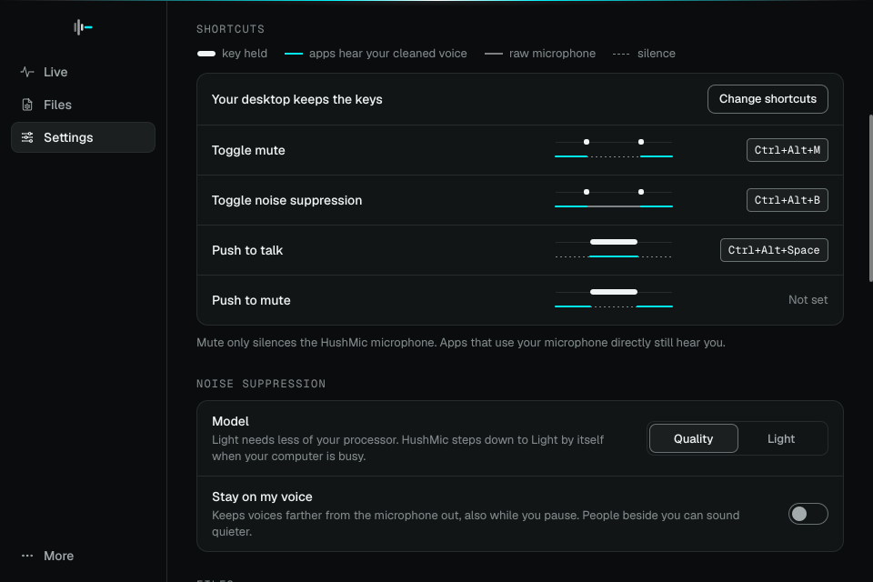
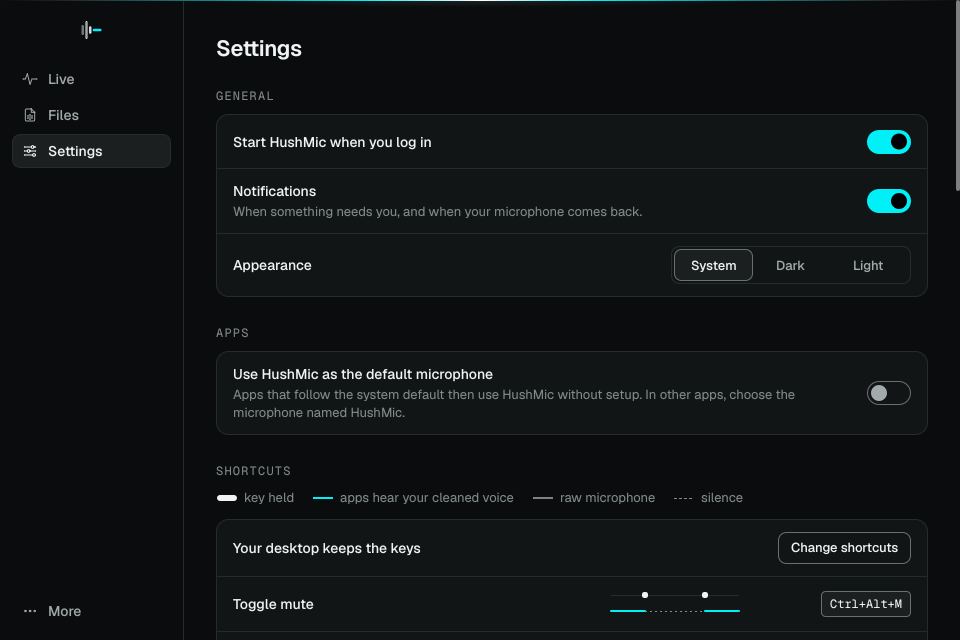

# Usage

## Launching

| command | what happens |
|---------|--------------|
| `hushmic` | tray icon plus the window; a second launch opens the window from the running instance |
| `hushmic --tray` | tray icon only; the autostart entry uses this |
| `hushmic --headless` | no icon, no window; see [headless.md](headless.md) |
| `hushmic --enable-once` | creates the virtual mic and waits for Ctrl+C; no watchdog, no CLI socket |
| `hushmic --doctor` | prints a diagnostics report and exits 1 when it finds problems |
| `hushmic --version` | version and install paths |

Only one instance runs per session. Quitting removes the virtual mic and restores the previous default input if HushMic had changed it.

## Modes

| mode | virtual mic carries |
|------|---------------------|
| `suppress` | your voice, cleaned |
| `bypass` | your raw voice, same latency |
| `mute` | silence |
| `off` | nothing; the virtual mic is removed |

Switching between suppress, bypass and mute changes a control on the running chain, so your call stays connected. Mute silences the virtual mic only; an app that captures the physical microphone directly still hears you.

In the window, **Noise suppression** is the row of steps under Live's picture: **Off** is bypass (the window and the tray call it **Noise suppression off**), and each of the four strengths is suppress at that strength, so choosing one while it is off turns it on again. **Mute** is at the top of the page. **Turn off HushMic** and **Quit HushMic** (Ctrl+Q) are under **More** at the bottom of the side bar. Ctrl+W closes the window and leaves HushMic running; Escape closes menus and dialogs, not the window. While an app is using HushMic, **Turn off HushMic** and **Quit HushMic**, here or in the tray (**Turn off HushMic**, **Quit HushMic**), ask first, as the app would then hear your microphone directly, with the noise; afterwards a notification says which app now hears which microphone, with a **Turn on** button.

The tray icon shows the state with the HushMic mark: noise bars that brighten into one line. On KDE and GNOME it is monochrome in your panel's own color: the bars and the line while suppressing, standing bars with an open ring and no line with noise suppression off, a slash through the mark while muted, the bars laid down to dots when off, and a warning badge on an error or when apps hear nothing (the microphone is unplugged with no other to stand in, or silent); the slash and the badge take the desktop's negative color, usually red. Other desktops get the colored set, drawn in mid-tones that read on dark and light panels: gray bars and a cyan line, the same shapes for the other states, a gray line when off, and a red slash and badge. The icon follows a switch between your desktop's light and dark style, and its tooltip says the state, the app using HushMic and the microphone ("HushMic: on · Zoom · Jabra headset"). The [`tray_icon`](#configuration) setting picks between the two, so `hushmic config set tray_icon color` brings the colored icons back on KDE and GNOME.

The tray menu has **Open HushMic** (a left click on the icon does the same), the four modes (**Noise suppression**, **Noise suppression off**, **Mute**, **Turn off HushMic**), the **Microphone** and **Strength** submenus, and **Quit HushMic**. A status line at the top shows only when something is unusual: HushMic needs attention, is reconnecting, the chosen microphone is unplugged (and which one stands in: "RODE NT-USB unplugged · using Jabra"), it has sent no sound to an app for 10 seconds (a hardware mute switch, a loose cable; one notification says so too, offers your other microphone when there is just one, and goes away once sound is back), or it runs the light model or unfiltered audio for now.

## Microphone, model and strength

**Microphone** on Live and in the tray lists the capture devices PipeWire sees. *System default* follows whatever the system default input is, including when you plug a headset in. If your chosen microphone disappears, HushMic falls back to the system default and switches back when it returns.

**Model** (in Settings): Quality (`dpdfnet8_48khz_hr`) or Light (`dpdfnet2_48khz_hr`), which needs less CPU. Changing the model restarts the chain (a short gap on the virtual mic). While HushMic runs the light model or unfiltered audio because the CPU is busy, Live says so and offers **Always use Light**.

**Strength** caps how much noise is removed: Maximum (100 dB), Strong (24), Medium (12) or Gentle (6). Lower values keep more of the room sound. A strength change applies without a gap. On Live the four are the steps after **Off** under the picture; **Off** leaves the microphone's strength as it is, and while HushMic is turned off the steps are greyed out and show the strength that waits. A value set with `hushmic config set attn_limit` that is not one of the four shows as a custom strength until you pick a step.

**Stay on my voice** (Settings › Noise suppression, off by default) keeps voices farther from the microphone than yours out: someone talking across the room, a colleague in an open office. On its own the model does this only for a few seconds after you spoke; after a pause of about ten seconds, or when the other voice does not stop, that voice comes through. With the switch on, HushMic keeps the model on the voice it last let through. It starts to work once you have spoken. The price: someone beside you who is quieter at the microphone than you loses the start of what they say and stays somewhat quieter, more so with the Light model; a voice as loud as yours takes over at once. Turning it on or off restarts the filter, which takes a moment. It applies to the live microphone only, not to Files.

Model and strength are remembered per microphone. A change goes to the microphone in use, also with *System default* selected (the device the default is now): from its first change that microphone keeps its own settings. Every microphone without its own settings shares the defaults (`model` and `attn_limit` in the file); a change goes to the defaults only when no microphone can be named. Settings › Microphones lists the microphone in use by name and each microphone with its own settings, and **Reset** makes one use the defaults again (`hushmic profile reset DEVICE` does the same). `hushmic status` says whose settings are in effect. With *System default* selected, the settings follow the default input: when it moves to another microphone for longer than a few seconds, HushMic restarts with that microphone's settings (a short gap). If the default keeps switching back and forth, those restarts get further apart, up to five minutes. Bluetooth headsets can show up as a different device per audio profile (for example music and headset mode), and each one has its own settings.

With **Use HushMic as the default microphone** on (Settings › Apps), HushMic is the default input and uses the microphone that was the default before. If you switch the system default to another microphone yourself, that switch stays: HushMic follows the new microphone with its settings and does not take the default back until you ask for it again: with **Make it the default again** in Settings › Apps, by turning HushMic on from off, or at the next start.

## Using the plugin in EasyEffects

The noise suppression lives in a LADSPA plugin, `libdpdfnet_ladspa.so`, and EasyEffects can load it directly. In EasyEffects, add **Deep Noise Remover** to the input or output effects and set its **Model** to *DPDFNet*. On the output side it cleans up what you hear, for example background noise from other people in a call. This needs an EasyEffects version with the DPDFNet model, added in October 2026.

- HushMic has to be installed, but it does not have to run. EasyEffects only uses the plugin and the model files.
- Install a package: the `.deb`, the AUR packages, the Fedora package, or the install script with its default `/usr` prefix. These put the plugin in `/usr/lib/ladspa/`, where EasyEffects looks for it. The AppImage keeps the plugin inside the image, and the Flatpak version of EasyEffects cannot see plugins installed on the system.
- EasyEffects has its own settings: its *Attenuation Limit* slider sets the suppression strength. HushMic's model, strength and microphone choices do not apply there.
- **Stay on my voice** is off in EasyEffects unless its environment has `HUSHMIC_VOICE_HOLD=1`.
- When the CPU gets tight, the plugin switches to the light model on its own and back later, as it does in HushMic. Past that the audio passes unfiltered until the load drops.
- Running HushMic's virtual mic and EasyEffects' Deep Noise Remover on the same microphone filters the audio twice and adds the latency twice. Use one or the other for your microphone.

## Replay the last 10 seconds

While the **Live** page is open, HushMic records its own output, so the picture moves even when no app uses HushMic, and it keeps the last 10 seconds. The picture is those 10 seconds as two bands on one time line, the newest sound at the right: your microphone above, what apps hear below. Low tones are at the bottom of a band and high ones at the top, and louder sound is brighter, so noise that fills the upper band is missing from the lower one. **Replay the last 10 seconds** (**Replay 10 s** in a narrow window) plays them through HushMic, on repeat until you press **Stop**; the picture stands still and a line moves across it as it plays. While it plays, hold the **Hold to hear the original** button, or Space anywhere on the page, to hear your microphone as it was at the same moment; let go to hear HushMic again. The band you are hearing is bright and says **Playing**; the other one is dimmed. Holding the button with no replay playing plays the original of the last 10 seconds for as long as you hold it, and stops when you let go. Space never starts or stops a replay. A short press switches to the original and stays there; press again to go back. The upper band is also where you choose the microphone (its name, after **Microphone**), and its right end says whether your voice sounds good, is very quiet or too loud. While muted the lower band is empty and says **Nothing, muted**; with noise suppression off it shows the same sound as the upper one and says **unfiltered**. Nothing is saved; leaving Live or minimising the window stops the recording.

`hushmic miccheck` is the test without a window: it records a few seconds, then plays them back raw and then cleaned, with notifications to guide you. If the window cannot open (no display, or no OpenGL), a notification says so and points to `hushmic miccheck`.

## Files

**Files** cleans recordings: audio or video, one file or many (WAV, MP3, M4A, FLAC, Opus, MP4, MKV and more).



### Adding recordings

**Choose files…** adds them, and so does dropping them on the page, **Clean with HushMic** in your file manager's *Open with* menu, or `hushmic open-files FILE|FOLDER…` (both start HushMic if it is not running). A folder gives the recordings in it, its top level unless `-r` is given (`-r` doesn't go into linked folders; a linked file is taken); files that only look like recordings by their name and HushMic's own cleaned copies next to their originals are left out, as on a drop. The AppImage adds no *Open with* entry; drop the files on the page or run it with `open-files FILE…`.

### While they clean

A file starts cleaning as soon as it is added. Several clean side by side, a quarter of your processor's cores' worth (at most three, at least one), and one at a time while an app uses HushMic; **Play** on a waiting file cleans it first, and **Clean next** puts it before the other waiting files. Cleaning goes on with the window closed, and a notification says when recordings are done. While an app uses HushMic and the live microphone is short of CPU (Live says it runs the light model, or that noise suppression is paused, for now), cleaning pauses until it recovers, so your call comes first; the row says **Paused for your call**, and **Clean anyway** cleans on until that call ends. Without a call, cleaning never waits.

### Listening and comparing

The picture at the top is the selected file from its start to its end, drawn as on Live: the original above and the cleaned copy below, which fills in from the left as the file cleans; the lower band says how far that is, and the strength once it is done. A line through both marks where you are, and the time and the file's length stand in the picture's upper right corner; click or drag anywhere on the picture to go there. **Play** listens while the file cleans. Hold the **Hold to hear the original** button, or Space, to hear the same moment of the original; let go to hear HushMic again. A short press switches to the original and stays there. The band you are hearing is bright, the other one dimmed. Playing past the part that is cleaned so far waits a moment until it catches up.

### The list

Each file has a row with its state (how long until it is ready, **Waiting**, **Cleaned · Strong**, **Saved · Strong**), its length, the one thing to do next as a button whose tooltip names it (a disk to **Save**, then a folder to **Show in folder**) and **×**, which takes it off the page. A file that is cleaned but not saved, or still cleaning, can be brought back with **Undo** for a few seconds. Clicking a file's name plays that one. The toolbar above the rows has **Add files…**, and **Save all** and **Clear all** once there are several. The list shows as many rows as it has, up to about two fifths of the page, and scrolls from there; the picture takes the rest.

### Strength

**Strength**, at the left of the row under the picture with **Play** and the hold button at its right, works as on Live, for the selected file and the files you add after it; each file keeps its own (its row says which), and **Save all** saves each at its own. Files start at **Strong**, and HushMic remembers the last one you chose. A file is cleaned once, at full strength; the strength mixes the original back in, so a change applies at once, while it plays and in the picture's lower band, without cleaning again. **Maximum** also silences the pauses between words; the strength's tooltip says what the chosen step does.

### Recordings with several sound tracks

A recording with more than one sound track (OBS writes one per source) is cleaned on one of them: the track whose title names a microphone or a voice (OBS's **Mic/Aux**, *Voice*, *VO*, *Vocals*), else the first. The other tracks, such as the desktop's music or a game, are copied into the cleaned file exactly as they are. Under the player, **Cleans track 2 · Mic/Aux, of 2** says which, and choosing another track there cleans that one instead.

### Saving

**Save** (or **Save all**) writes the cleaned copy next to the original, as `NAME (cleaned).EXT`, then `NAME (cleaned 2).EXT` and so on; saved again at another strength, the name says it: `NAME (cleaned, Gentle).EXT`. A saved row's tooltip names the file it wrote. The original is never changed, and nothing is written before you save. The copy keeps the original's format, and a video keeps its picture untouched; both need `ffmpeg` (see [troubleshooting.md](troubleshooting.md#cleaned-files-are-flac-or-a-video-lost-its-picture)). An MP3, M4A or FLAC keeps its cover picture; an Opus or Ogg file loses it. **Save all** saves the files that are cleaned now and the rest as each one finishes (their rows say **Saves when cleaned**). **Clear all** takes every file off the page at once; saved copies stay on the disk, and **Undo** brings the files back for a few seconds.

A damaged recording (cut short, or broken partway) says how much of it can be cleaned; after **Clean the first m:ss**, Save saves that part. A file that was moved or deleted while it was on the page is not saved; add it again from where it is now. A Save that fails says why, and what to do: a folder that cannot be written (its permissions, or a read-only disk) offers **Choose another folder…**, a full disk **Save elsewhere…**, and anything else (the encoder, the original that cannot be read again, a disk error) **Save again**. A failed Save leaves no partial file behind.

### Where cleaned files go

**Settings › Files** sets where Save puts cleaned files: **Next to the original** (the default) or **In a folder…**, which asks for the folder once; **Change…** picks another. **Save elsewhere…** still saves one file anywhere. HushMic looks at the chosen folder when Files opens, before each Save, and every 30 seconds while Files is shown. If the folder is gone, Save writes the copy next to the original, the page says so, and HushMic stops using the folder; if it does not answer within 10 seconds (a network share that is offline), that Save goes next to the original and says so, and the folder stays chosen.

The Flatpak is different: it can only see the files it was given, so it cannot write next to them. The first Save asks **Choose where cleaned files go** and remembers the folder; pick the recordings' own folder to keep the copies beside the originals. **Settings › Files** shows the folder, and **Change…** there picks another. If the folder is gone, the next Save asks again; if it does not answer within 10 seconds (a network share that is offline), that Save asks where, and the folder stays chosen.

### Quitting with files on the page

Quitting while files clean or save, or with cleaned files not saved, from the tray, **More › Quit HushMic** or Ctrl+Q, asks one question first, on the Files page: **Save all and quit** saves them (each once it is cleaned) and then quits, **Quit** stops them (a file not saved yet is cleaned again when you add it next time), **Keep cleaning** keeps HushMic running. While an app is using HushMic, the same question also says so, as quitting removes the HushMic microphone from that app. Quitting again while it asks quits at once, and so does the first **Quit** in the tray when the window cannot open. If the files finish while it asks, the question becomes **Quit HushMic?** with **Quit** and **Cancel**, and stays until you answer.

### Disk space

While a file is on the page, its cleaned sound is kept in HushMic's cache folder (`~/.cache/hushmic/files`), f32 audio at 48 kHz: about 0.7 GB per channel per hour, and next to it the file's picture, under 0.3 MB. The page says when the disk is too full for it. The folder goes when the file leaves the page.

### From a terminal

`hushmic clean FILE…` cleans recordings from a terminal, without the window or a running HushMic, and saves them the same way:

```text
hushmic clean FILE|FOLDER… [-r] [--strength gentle|medium|strong|maximum] [--model quality|light] [--track N|all] [--out DIR] [--json] [--quiet]
```

A folder is cleaned file by file, as `open-files` takes it: its top level, or with `-r` the folders in it too; a folder with no recording in it counts as a file that could not be cleaned. `--strength` defaults to `strong`, as on the Files page, and `--model` to the model in the config file. `--track N` cleans a recording's Nth sound track (1 the first) and `--track all` every one; by default it cleans the voice's, as the page does, and copies the others as they are.

Like the page, it cleans at idle priority (and on the efficiency cores of hybrid Intel CPUs), so a call on the live microphone comes first; `HUSHMIC_NO_CPU_PIN=1` lets it use every core. It checks first that the cleaned sound fits in the cache folder. `--out DIR` saves into DIR instead of next to each original (the folder in Settings › Files is the window's; it does not apply here).

It prints one line per file (`FILE → OUTPUT`, or `FILE: what went wrong`); `--json` prints one JSON object per file instead: `file`; `output` (where the copy went) and `same_format`, once saved; `strength` and `model`; `tracks` and `tracks_dropped` (the sound tracks the copy keeps, and those of the original it lacks); `track_cleaned` (a number from 1, or `"all"`; null for a file that did not open); `damaged_at` (a damaged file: how much was cleaned, in seconds to the millisecond); `reduced_quality` (true: cleaned from an HE-AAC file's core, without ffmpeg); and for a file that could not be cleaned, `problem` (a stable word: `not_media`, `unreadable`, `no_sound`, …) and `detail`. A file a folder left out gets a line too, with `problem` `skipped` and `detail` saying why; it does not count as a failure.

Exit codes: 0 every file cleaned, 1 some could not be, or only in part, or invalid usage. A damaged file (cut short, or broken partway) is cleaned as far as it can be read and saved; its line ends with `(damaged: the first m:ss only)` and it counts towards exit code 1.

## Keyboard shortcuts

**Settings › Shortcuts** lists four actions with the keys your desktop reports for them: toggle mute, toggle noise suppression (bypass), push to talk (live only while held) and push to mute (silent while held). **Set up shortcuts** opens your desktop's key-binding dialog (`hushmic shortcuts setup` does the same). The compositor grabs the keys, so they work in any app. After the first setup the button reads **Change shortcuts** and opens the desktop's shortcut editor; the keys also show up in your system's keyboard settings.



On KDE Plasma before 6.4 (Kubuntu 24.04, Debian 12 and 13) HushMic registers the actions with Plasma's own shortcut service instead, and the section's **Open System Settings** opens HushMic's page under Shortcuts, where you assign the keys. The Flatpak cannot reach that service: on Plasma 5 it has no shortcuts, and on Plasma 6.0 to 6.3 System Settings opens on each start once they are set up. Elsewhere this needs the GlobalShortcuts portal (Plasma 6.4 and later, GNOME 45 and later). Where it is missing, the section says so; add the commands below as custom shortcuts in your desktop's keyboard settings instead (push to talk and push to mute need the desktop's shortcut support). Starting HushMic from a terminal additionally needs xdg-desktop-portal 1.18 or newer so it can identify itself to the portal; app-menu and autostart launches do not.

## Settings

**Settings** holds start on login, notifications and the appearance (System follows your desktop's light or dark style), HushMic as the default microphone, the shortcuts, the model and **Stay on my voice**, the tray icon and its set, each microphone's own settings, where cleaned files go (Files), the model engine, and About with **Copy diagnostics**, the website and the licenses. Most of them are also [config keys](#configuration).



## Command line

```text
hushmic status [--json]        what the running instance is doing
hushmic mode [STATE]           print or set: suppress | bypass | mute | off
hushmic toggle mute|bypass     enter the state, or leave it for the previous one
hushmic unmute-to suppress|bypass   what unmuting returns to (not muted: the next mute's; push to mute ignores it)
hushmic quit [--force]         stop the running instance (returns once it is gone);
                               refuses while files clean or wait to be saved
                               (--force quits all the same)
hushmic watch                  its state as JSON lines, one per change
hushmic refresh                re-read PipeWire now
hushmic retry                  retry a microphone that is down, now
hushmic shortcuts setup        open the desktop's shortcut dialog
hushmic miccheck               record a few seconds, play them back raw, then cleaned
                               (returns when both have played)
hushmic notice hide|show APP   leave APP out of the apps listed as recording the microphone directly
hushmic profile reset DEVICE   forget a microphone's own settings

hushmic open-files FILE|FOLDER… [-r]  put recordings on the Files page (starts HushMic if needed)
hushmic clean FILE|FOLDER… [OPTIONS]  clean recordings without the window, see Files

hushmic config [--json]        every setting, one per line
hushmic config get KEY [--json]
hushmic config set [--defaults] KEY VALUE
hushmic config path
hushmic devices [--json]       microphones you can pass as `mic`
hushmic service install|uninstall   see headless.md
```

`status`, `mode`, `toggle`, `unmute-to` and `quit` talk to the running instance over a socket. Exit codes: 0 ok, 1 invalid usage or a failed command, 2 HushMic is not running, and 3 for `--tray`, `--headless` or `--enable-once` when another instance already runs (0 when systemd started it, so a unit never restarts on it). `hushmic COMMAND --help` (or `hushmic help COMMAND`) shows one command's usage; `-V` is `--version`. `toggle mute` twice returns you to the state you came from, so one key can serve as a mute button. `mode off` while apps record HushMic says on stderr which microphone they now hear, and `mode suppress`, `bypass` or `mute` afterwards moves exactly those apps back onto HushMic (an app that records the microphone directly by its own choice stays there). `watch` prints one JSON line per change until HushMic goes: after a quit its last line is `{"event":"stopped"}` and it exits 0; when the connection just ends (HushMic crashed or was killed) it prints `{"event":"lost"}` and exits 1. For push to talk in a window manager that binds key presses and releases separately, see [headless.md](headless.md#push-to-talk-in-sway-i3-and-other-window-managers).

What `status` shows:

- `engine:` is what the chain runs right now: `quality model`, `light model` or `passthrough`, followed by the inference engine, for example `quality model (native w7a8 avx2)`.
- `tray:` is `registered`, `waiting` (no tray on the desktop yet; retried) or `disabled` (`--headless` or `tray = false`), the same words as in `watch`. Under CPU pressure HushMic falls back to the light model or to unfiltered audio and climbs back later, see [troubleshooting.md](troubleshooting.md#latency-and-cpu).
- `mic:` names the microphones as the window does: `Built-in Audio (fallback; Jabra Evolve2 is unplugged)`.
- `chain:` reads `running, idle (not processing audio right now)` while PipeWire has paused the filter chain because nothing is reading from it, and `running, not linked (no microphone is connected to it)` when no microphone has reached it for 5 seconds.
- `model:` and `strength:` show the settings in effect and whose they are, for example `strength: 100 dB (RODE NT-USB profile)` or `(defaults)`.
- `apps:` names the apps recording HushMic, and in brackets the apps recording the microphone directly, without noise suppression: `apps: Zoom, Teams (direct: Slack)`, or `none`. An app whose own settings keep linking it into HushMic's microphone input is named as kept off it: `(kept off HushMic's microphone: Firefox)`.

In `status --json`:

- `running` is `true`; with nothing running, `status --json` prints `{"running":false}` and exits 2.
- `mic.configured` and `mic.active` are node names.
- `engine` is `quality`, `light` or `passthrough`.
- `inference` says what the running model runs on: `engine` is `native w7a8 avx2`, `native w7a8 avx-vnni` or `onnx`, and `reason` says why ONNX runs. It is `null` while nothing is reported.
- `model` and `attn_limit` are the values in effect, `profile` is the node name of the microphone they belong to (`null` for the defaults), and `defaults` holds the default `model` and `attn_limit`.
- `apps.using` lists the apps recording HushMic and `apps.direct` the apps recording the microphone directly, with the same fields as in `watch`; `apps.kept_off` names the apps HushMic keeps off its microphone input (see [troubleshooting.md](troubleshooting.md#an-app-was-linked-into-hushmics-microphone)).
- `chain.node_state` is PipeWire's state for HushMic's virtual microphone (`running`, `idle`, `suspended`), and `chain.idle` is `true` for `idle` and `suspended`. Both are `null` while unknown or with the chain off. `chain.linked` is `false` once no microphone has reached the chain for 5 seconds.

`config set` applies the change immediately while HushMic runs and writes it to the file otherwise, with the same validation either way. A value out of range is refused, not clamped. Setting a `mic` HushMic cannot capture from right now is saved with a warning; until it appears, HushMic follows the system default. `config` and `config get` read the running instance's settings when there is one, else the file. `model` and `attn_limit` follow the window's rule: `config get` shows the settings in effect and `config set` changes them where the window would (the microphone in use, which keeps its own settings from then on, or the defaults when no microphone can be named). Without a running instance they refer to the microphone HushMic would start with. `config set` says where it saved them (`attn_limit = 24 (saved for usbmic; the defaults stay 100)`), and `config set --defaults KEY VALUE` sets the defaults instead, for every microphone without its own. A model is said back in the words `set` takes (`model = light`), while `config get` shows the stored id. `hushmic config --help` lists every key with its values.

## Configuration

The file is `~/.config/hushmic/config.toml` (`hushmic config path` prints the exact location). Set keys with `hushmic config set KEY VALUE`:

| key | values | default | applied |
|-----|--------|---------|---------|
| `mic` | a node name from `hushmic devices`, or `default` | `default` | live |
| `model` | `quality` or `light` (stored as `dpdfnet8_48khz_hr` and `dpdfnet2_48khz_hr`, which are accepted too), for the settings in effect | `dpdfnet8_48khz_hr` | live, restarts the chain |
| `attn_limit` | 0 to 100 (dB), or `maximum`, `strong`, `medium`, `gentle` (`light` also works), for the settings in effect | `100` | live |
| `set_default` | `true` or `false`: make HushMic the system default input (a switch away by hand sticks until the next start, turning HushMic on from `off`, or setting it on again) | `false` | live |
| `autostart` | `true` or `false`: desktop autostart entry | `false` | live |
| `tray` | `true` or `false`: register a tray icon | `true` | next start |
| `tray_icon` | `auto`, `color` or `symbolic`: which tray icon set to use | `auto` | live |
| `notifications` | `true` or `false`: desktop notifications (a problem the window shows waits while the window has focus on a page that shows it, and goes out once it no longer does, if it is still so) | `true` | live |
| `inference` | `auto` or `onnx`: which engine runs the model | `auto` | live, restarts the chain |
| `voice_hold` | `true` or `false`: **Stay on my voice**, keep voices farther from the microphone out | `false` | live, restarts the chain |
| `appearance` | `system`, `dark` or `light`: the window's colors; `system` follows the desktop | `system` | live |

Booleans also accept `on`/`off`, `yes`/`no` and `1`/`0`. `tray = false` hides the icon; a plain `hushmic` launch still opens the window, so use `--headless` when you want neither.

`tray_icon = auto` picks the monochrome icons on KDE and GNOME, which recolor them to match the panel, and the colored ones everywhere else. `color` and `symbolic` pin the choice. `symbolic` on a desktop that does not recolor panel icons (LXQt, for example) can come out near-black on a dark panel. If the monochrome files are not installed (an older package, a plain `cargo build`), the desktop shows the colored icon.

`inference = auto` runs the models on the native engine where the CPU supports it (x86-64 with AVX2 and FMA) and its weight files are installed, and on ONNX Runtime otherwise. `onnx` always uses ONNX Runtime. A change restarts the filter chain, which takes a moment. `hushmic status` shows the engine in use.

`hushmic config` lists the keys above and `mic_prefs`; `config --json` uses the same words (`"mic": "default"`). The file also holds `enabled` (set with `hushmic mode`), `mic_prefs` (model and strength per microphone), `shortcuts_setup`, `hidden_notices` (apps left out of the list of apps recording the microphone directly, set with `hushmic notice`), `close_notice_sent` (the first close of the window said that HushMic keeps running), `files_folder` (where cleaned files go when not next to the original: Settings › Files, or in the Flatpak the first Save) and `files_strength` (the strength the Files page starts new files at), all managed by the app. The top-level `model` and `attn_limit` are the defaults for microphones without an entry in `mic_prefs`. `tray` and `notifications` are only written when false, `tray_icon` and `inference` when they are not `auto`, `appearance` when it is not `system`, `mic_prefs` and `hidden_notices` when non-empty and `shortcuts_setup` and `close_notice_sent` when true, so a file from an older version stays unchanged.

`SIGTERM`, `SIGINT` and `SIGHUP` all stop HushMic cleanly. There is no reload signal; use `hushmic config set`.
